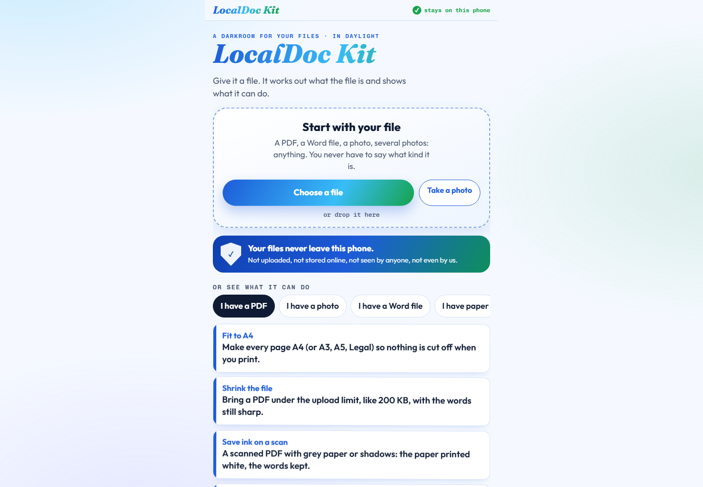

# LocalDoc Kit

## Fix the file. Keep it on your device.

A form wants a 200 KB PDF. Your signature is a photo. The document you need to edit is locked inside a PDF. Somehow each small job sends you to another website asking for the whole file.

I built LocalDoc Kit to do those jobs in the browser, on the device holding the document.

**[Open LocalDoc Kit](https://arnav-agarwal137.github.io/localdoc-kit/) · [Privacy](privacy.html) · [Report a problem](https://github.com/Arnav-Agarwal137/localdoc-kit/issues)**

You can open it on a phone or computer. You do not need an account, subscription or installation.

## Start with the file you have

Choose a file, take a photo, or drop a file onto the page. LocalDoc Kit works out its type and shows the tools that can handle it.

| The job | What you can do |
|---|---|
| An upload box refuses your file | Shrink a PDF, resize a photo or fit a signature to a KB limit |
| You need to edit a PDF | Convert it to Word; extract tables to Excel or CSV |
| You need to print | Fit pages to A4, put two pages on a sheet or arrange a booklet |
| A scan is hard to use | Recognise text, clean the page background or save pages as pictures |
| A document will not open | Attempt to recover the parts that are still readable |
| A long file needs reading | Open the book reader, navigate chapters and tap difficult words |

The page also includes tools for audio, video, slides, contacts and application paperwork. Entries marked as being made are not finished features.

## Your first useful result

1. [Open the app](https://arnav-agarwal137.github.io/localdoc-kit/).
2. Choose an ordinary PDF or photo to try first.
3. Pick a tool such as **Shrink the file** or **Pages to pictures**.
4. Save the result as a new copy and check it before submitting it anywhere.

Larger tools download their helpers when first needed. PDF-to-Word can download a roughly 36 MB runtime and take minutes on a phone. The page tells you before it starts. A warm browser cache helps, but this is not a promise that every tool works offline.

## What happens to your documents?

**The conversion tools process your files on your own device.** I do not run a document-upload server for them. The app has no account system, analytics or adverts.

There are explicit exceptions for optional online tools:

- **Is this book free?** sends the book title to book-search services.
- **Book words** can send book text to an AI provider using your own key, after you choose that option.
- Downloading a library or model contacts its host, which receives normal connection information such as your IP address.

The request counter names the page's internet requests. Read [privacy.html](privacy.html) before using sensitive documents.

## How it is built

The published app is `index.html`, a standalone browser page. The browser runs the document, image and media processing; some heavier tools load Python through Pyodide or a model through an ONNX runtime.

Components include pdf-lib, PDF.js, Tesseract, pdfminer, pypdf and other libraries. Their licences and sources are in [THIRD-PARTY-NOTICES.md](THIRD-PARTY-NOTICES.md), with full texts inside **Licences and privacy** in the app.

For a local copy, download this repository and open `index.html`. Keep `privacy.html`, `LICENSE.txt` and the notices beside it. The public repo contains the browser release, not the private development workspace or its test documents.

## Before relying on a result

Keep your original file. PDF-to-Word conversion, OCR and recovery can lose layout or misread text. Check the result. Health tools provide educational information, not diagnosis or treatment. Forms and document explainers provide general information, not legal advice or official approval.

If something fails, [open an issue](https://github.com/Arnav-Agarwal137/localdoc-kit/issues) with the tool, browser and error message. Do not attach a private document; a small invented example is much more useful.

Built by [Arnav Agarwal](https://github.com/Arnav-Agarwal137). [More projects](https://arnav-agarwal137.github.io/).

## Licence

Free noncommercial use and private improvements are permitted for newly licensed original work.
Share the official links freely. Redistributing copies, publishing modified versions, public mirrors,
rebranding, and commercial use require Arnav Agarwal's prior written permission.
Keep authorship and required notices. This is a source-available custom licence, not an open-source licence.
Earlier licence grants and third-party rights remain in force; see [LICENSE-HISTORY.md](LICENSE-HISTORY.md).
Previously published source, embedded app notices, tags and downloadable binaries retain their earlier grants;
this policy does not retroactively prohibit their previously permitted use or distribution.

Full terms: [LICENSE.txt](LICENSE.txt). Permission requests: [GitHub issues](https://github.com/Arnav-Agarwal137/localdoc-kit/issues).

Third-party notices: [THIRD-PARTY-NOTICES.md](THIRD-PARTY-NOTICES.md). Health, official-document and privacy terms remain applicable.
